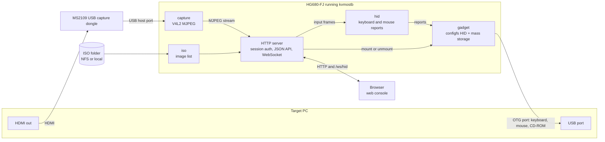
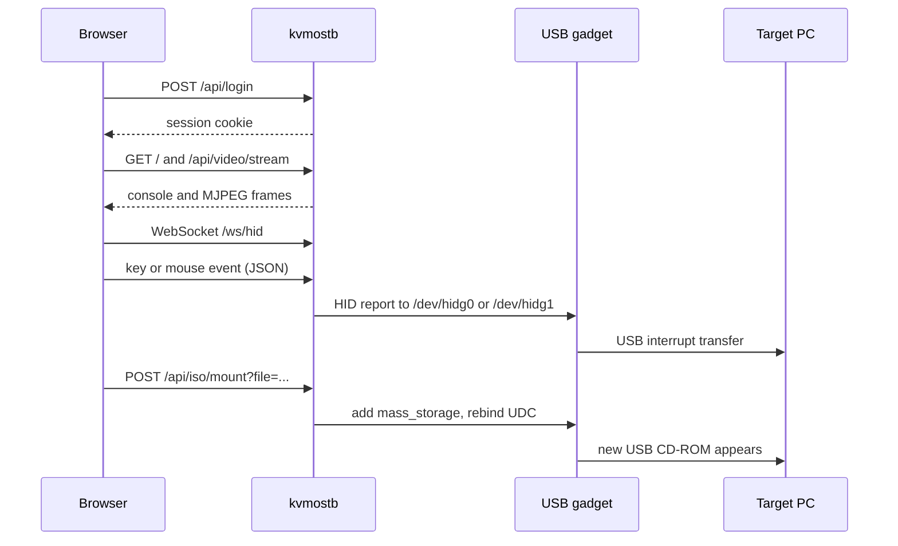

<p align="center">
  
</p>

<h1 align="center">KVMoSTB</h1>

<p align="center">
  KVM over IP for a homelab PC, built on a Telkom IndiHome HG680-FJ set-top box.
</p>

KVMoSTB turns an HG680-FJ into a small KVM-over-IP appliance. Open its web console in a browser to watch the target PC's screen, type, click, and mount an ISO as a USB CD-ROM. The target PC runs no agent and no driver, so it works in BIOS and UEFI.

It is one Go binary with the web console embedded, two systemd units and a `.deb` package.

## Contents

- [Features](#features)
- [Architecture](#architecture)
- [Hardware](#hardware)
- [Screenshots](#screenshots)
- [How it works](#how-it-works)
- [Build](#build)
- [Install](#install)
- [Configuration](#configuration)
- [Limitations](#limitations)
- [Credits](#credits)
- [License](#license)

## Features

- **Video.** MJPEG from a USB capture dongle at 640x480, 1280x720 or 1920x1080, at 25, 30 or 60 fps. The default is 1280x720 at 30 fps. Fullscreen, screenshots, and live resolution, frame rate and bitrate.
- **Keyboard and mouse.** Physical keys, a full-size on-screen keyboard with sticky Ctrl and Alt, a clipboard box that types text into the target, and an absolute mouse.
- **Virtual media.** Mount an ISO from an NFS share or a local folder as a USB CD-ROM, and unmount it, from the console.
- **Sign-in.** A form login with a session cookie. It fails closed: with no credentials configured, nobody can sign in.
- **Boot to ready.** Two systemd units bring the USB gadget and the console up after every reboot.

## Architecture



| Package | Role |
| --- | --- |
| `cmd/kvmostb` | Entry point, HTTP routing, session auth and the embedded web console. |
| `internal/capture` | Opens the V4L2 device, builds the resolution menu and streams MJPEG. |
| `internal/gadget` | Builds the USB gadget in configfs, binds the UDC and swaps the ISO. Its async writer ships reports to `/dev/hidg0` and `/dev/hidg1`. |
| `internal/hid` | Turns browser key codes and mouse events into boot-keyboard and absolute-mouse reports. |
| `internal/iso` | Lists `.iso` files in the search roots. |
| `internal/logging` | Leveled logging on top of the standard library. |

## Hardware

### What you need

| Part | Notes |
| --- | --- |
| Telkom IndiHome HG680-FJ | Amlogic S905X2, 4x Cortex-A53, 2 GB RAM, 8 GB eMMC. Runs Armbian Trixie with a 6.12 kernel (`6.12.117-ophub` was tested). |
| MACROSILICON MS2109 capture dongle (`534d:2109`) | HDMI in, UVC out. Plug it into the STB's USB 3.0 host port. |
| USB A-to-A cable | From the STB's USB 2.0 port to a USB port on the target PC. |
| USB 2.0 hub (optional) | The hub tested here is a 4-port VIA Labs `2109:2822` with a built-in AX88179A gigabit NIC. A self-powered hub is safer. |
| HDMI cable | Target PC to the capture dongle. |

### Ports on the STB

| Port | Controller | Use |
| --- | --- | --- |
| USB 3.0 | dwc3 (xHCI) | Host. The hub, the capture dongle and the optional gigabit NIC hang off it. |
| USB 2.0 Type-A | dwc2 OTG (`ff400000.usb`) | Device. It presents the keyboard, mouse and CD-ROM to the target PC. |

```text
dwc3 USB 3.0 host port
└── VIA Labs 2109:2822 USB 2.0 hub
    ├── ASIX 0b95:1790 AX88179A gigabit NIC (driver cdc_ncm)
    └── MACROSILICON 534d:2109 capture dongle (UVC)

dwc2 USB 2.0 OTG port ── A-to-A cable ──> target PC
```

### Kernel requirements

The gadget needs these kernel options, all present in the tested kernel:
`CONFIG_USB_DWC2`, `CONFIG_USB_CONFIGFS`, `CONFIG_USB_CONFIGFS_F_HID`, `CONFIG_USB_CONFIGFS_MASS_STORAGE`, `CONFIG_USB_ROLE_SWITCH` and `CONFIG_USB_VIDEO_CLASS`.

### Known hardware limits

- Everything on the USB 3.0 port shares one USB 2.0 bus of 480 Mbps. 1080p60 MJPEG is about 160 Mbps and can starve the NIC; 1080p30 is the safe setting.
- The STB's USB power is weak. If devices drop out, use a self-powered hub.
- The ASIX NIC needs the `cdc_ncm` module, which the Armbian image does not load by default. Add `cdc_ncm` to `/etc/modules-load.d/usb-net.conf`.
- The board has no video input. The capture dongle is required.

The device tree source for this board is in [ophub/amlogic-s9xxx-armbian#3089](https://github.com/ophub/amlogic-s9xxx-armbian/pull/3089).

## Screenshots

<!-- TBD: the maintainer adds these by hand. -->

| Console | Login |
| --- | --- |
| _TBD_ | _TBD_ |

| On-screen keyboard | Virtual media |
| --- | --- |
| _TBD_ | _TBD_ |

## How it works

### Video

The MS2109 turns the target's HDMI output into a USB video stream. `kvmostb` opens it through V4L2 and serves the MJPEG frames as a multipart HTTP stream, which the browser shows in an `` tag. The resolution menu is the fixed list above intersected with what the dongle advertises, so the 25 fps option exists only at 1080p. One client streams at a time, and a new client takes over from the old one.

### Keyboard and mouse

The STB's OTG port runs a USB gadget built through configfs: a boot keyboard with an 8-byte report and an absolute mouse with a 6-byte report. The browser sends each key and mouse event as JSON over a WebSocket (`/ws/hid`). `internal/hid` turns it into a report, and a per-device writer goroutine writes the report to `/dev/hidg0` or `/dev/hidg1`. A write to those files blocks until the target polls the endpoint, so each device has its own bounded queue. A full queue drops the oldest report, and one stuck device cannot stall the other.

Browsers send mouse coordinates as 12-bit values (0-4095). The gadget uses 16-bit values (0-32767), so the mouse code rescales them.

### Virtual media

The gadget starts with no mass-storage function. Mounting an ISO from the console adds a `mass_storage` function with the image as its backing file and rebinds the UDC, so the target sees a new USB CD-ROM. Unmounting removes the function the same way. The search roots are `/mnt/shared/iso` (NFS) and `ISO_LOCATION_DIR`.

### Sign-in

`POST /api/login` checks `ADMIN_USER` and `ADMIN_PASSWORD` in constant time and sets an `HttpOnly` session cookie that lasts 12 hours. Every route except `/healthz`, the login page and its static assets needs that cookie. API and WebSocket routes answer 401 without it, and other routes redirect to `/login`.

### Start-up

| Unit | Job |
| --- | --- |
| `kvmostb-gadget.service` | A oneshot that runs `kvmostb -gadget-init`. It retries up to five times, because the first attempt can fail with `EBUSY` while stale configfs state still holds the UDC. |
| `kvmostb.service` | The daemon. It starts after the gadget unit and restarts on failure. |

The gadget code first writes `device` to `/sys/class/usb_role/*/role`. On the S905X2 the dwc2 and dwc3 controllers share one USB 2 PHY. Setting `dr_mode` on the dwc2 node does not switch the PHY, so without this write the link never reaches `configured`.



### API

| Route | Method | Purpose |
| --- | --- | --- |
| `/healthz` | GET | Liveness probe, no sign-in. |
| `/api/login`, `/api/logout` | POST | Start and end a session. |
| `/api/status` | GET | Video, USB state and mounted ISO. |
| `/api/video/stream` | GET | MJPEG stream. |
| `/api/video/screenshot` | GET | One JPEG frame. |
| `/api/video/resolutions` | GET | The resolution and frame-rate menu. |
| `/api/video/resolution` | POST | Set `width`, `height` and `fps`. |
| `/ws/hid` | WebSocket | Keyboard and mouse events. |
| `/api/hid/reset` | POST | Release every key and button. |
| `/api/hid/jiggler` | GET, POST | Read or set the mouse jiggler. |
| `/api/iso/list` | GET | ISO files in the search roots. |
| `/api/iso/status` | GET | Mounted ISO and USB state. |
| `/api/iso/mount` | POST | Mount `?file=<path>`; with no `file`, unmount. |

## Build

You need Go 1.24 or newer. The three Go dependencies are vendored in `third_party/`, so the build needs no network.

`go4vl` uses cgo for the V4L2 headers, so building for arm64 from an amd64 machine needs a cross compiler. On Debian or Ubuntu:

```sh
sudo apt-get install gcc-aarch64-linux-gnu libc6-dev-arm64-cross linux-libc-dev-arm64-cross dpkg
```

Run the tests, then build the package:

```sh
go test ./...
./packaging/build-deb.sh                  # dist/kvmostb_1.0.0_arm64.deb
VERSION=1.0.1 ./packaging/build-deb.sh    # another version
```

To build on the STB itself, install `gcc` and run `go build -o kvmostb ./cmd/kvmostb`.

### Releases

Pushing a tag such as `v1.0.0` starts `.github/workflows/release.yml`. It runs the tests, builds `kvmostb_1.0.0_arm64.deb`, checks that the binary is arm64, and attaches the package and its SHA-256 checksum to a GitHub release.

```sh
git tag v1.0.0
git push origin v1.0.0
```

The workflow can also run by hand from the Actions tab with a version number. That run keeps the package as a build artifact and does not publish a release.

## Install

1. Download `kvmostb_<version>_arm64.deb` from the [releases page](https://github.com/vikipranata/KVMoSTB/releases) and copy it to the STB.
2. Install it. `dpkg` pulls in `kmod` and `v4l-utils` if `apt` resolves the dependencies:

   ```sh
   sudo apt install ./kvmostb_1.0.0_arm64.deb
   ```

3. Set the credentials. The service refuses every sign-in until both are set:

   ```sh
   sudoedit /etc/kvmostb/kvmostb.env      # set ADMIN_USER and ADMIN_PASSWORD
   sudo systemctl restart kvmostb
   ```

4. Cable it up: the capture dongle in the USB 3.0 port, HDMI from the target PC to the dongle, and the A-to-A cable from the STB's USB 2.0 port to the target.
5. Open `http://<stb-address>:8080` and sign in.

To put ISO images on the STB, copy them to `/var/lib/kvmostb/iso`, or mount an NFS share at `/mnt/shared/iso`.

Check the services with:

```sh
systemctl status kvmostb-gadget kvmostb
journalctl -u kvmostb -f
```

Upgrading is the same `apt install ./kvmostb_<new>.deb`. It keeps `/etc/kvmostb/kvmostb.env` and restarts the service.

## Configuration

`/etc/kvmostb/kvmostb.env` is read by `kvmostb.service`.

| Variable | Default | Meaning |
| --- | --- | --- |
| `ADMIN_USER` | none | Sign-in user. Required. |
| `ADMIN_PASSWORD` | none | Sign-in password. Required. |
| `LISTEN_ADDRESS` | `0.0.0.0` | Address to listen on. |
| `LISTEN_PORT` | `8080` | Port to listen on. |
| `ISO_AUTO_MOUNT` | `false` | Set to `true` to mount the newest ISO at boot. |
| `ISO_LOCATION_DIR` | `/var/lib/kvmostb/iso` | Local ISO folder. `/mnt/shared/iso` is always searched first. |
| `LOG_LEVEL` | `info` | `debug`, `info`, `warn` or `error`. |

The binary also takes `-video`, `-listen`, `-jpeg-quality` and `-log-level` flags. `-video` is auto-detected when empty, so the dongle keeps working if its `/dev/videoN` number changes.

## Limitations

- The console speaks plain HTTP and keeps sessions in memory. Sessions end when the service restarts, and login attempts are not rate limited. Put the console behind a VPN or a reverse proxy with TLS before you expose it beyond your LAN.
- The mouse is absolute and declared as a boot mouse. BIOS or UEFI firmware that binds the boot-mouse protocol may misread it. Operating systems are unaffected. This has not been tested on real firmware.
- Typing into a Linux text console works only when that console is the foreground virtual terminal. Run `sudo chvt 1` on the target if text goes nowhere.
- The capture dongle has no audio, so there is no sound.
- The 1.0.0 release was tested with the STB cabled to itself, not against a separate target PC. See [CHANGELOG.md](CHANGELOG.md) for the details.

## Credits

KVMoSTB started from ideas in the projects below. Thank you to their authors.

| Project | Used for | License |
| --- | --- | --- |
| [DezKVM-Go](https://github.com/tobychui/DezKVM-Go) by Toby Chui | The starting point: the `/ws/hid` input protocol and the MS2109 capture approach. | GPL-3.0 |
| [go4vl](https://github.com/vladimirvivien/go4vl) by Vladimir Vivien | V4L2 capture. Vendored in `third_party/`. | MIT |
| [gorilla/websocket](https://github.com/gorilla/websocket) | The `/ws/hid` WebSocket. Vendored in `third_party/`. | BSD-2-Clause |
| [golang.org/x/sys](https://pkg.go.dev/golang.org/x/sys) | System calls used by go4vl. Vendored in `third_party/`. | BSD-3-Clause |
| [simple-keyboard](https://github.com/hodgef/simple-keyboard) by Francisco Hodge | The layout pattern of the on-screen keyboard. | MIT |
| [noVNC](https://github.com/novnc/noVNC) | The local-scaling behavior of fullscreen. | See its repository |
| [ophub/amlogic-s9xxx-armbian](https://github.com/ophub/amlogic-s9xxx-armbian) | The Armbian image and the device tree for the HG680-FJ. | See its repository |

Technology: [Go](https://go.dev), the Linux USB gadget framework (configfs, `f_hid`, `f_mass_storage`), V4L2 and [Mermaid](https://mermaid.js.org) for the diagrams.

## License

KVMoSTB is free software under the [GNU General Public License v3.0](LICENSE), or any later version.
